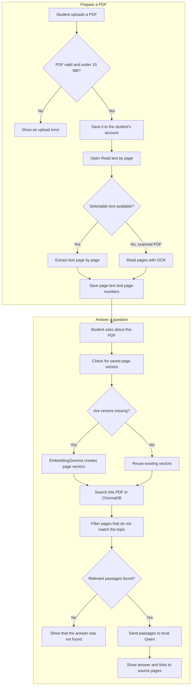

https://github.com/user-attachments/assets/01fe1a54-3050-47b7-be7d-872a90425937

# Docs AI

### Ask a PDF. Check which pages support the answer.

Docs AI is a local study app built with Django. Upload your notes, ask a question, and get an answer based on passages from that PDF. The app shows the matching pages so you can check the answer against the source.

It uses Ollama models on your computer. You do not need an OpenAI API key.

## A student's path through Docs AI

1. Create an account and upload a PDF.
2. Open **Read text by page** once. Docs AI extracts selectable text or uses OCR for scanned pages, then saves the text page by page.
3. Open **Ask this PDF** and ask a question. On the first search, Docs AI creates any missing page vectors and searches only this PDF.
4. Read the answer and open the source page links to check the supporting passages.
5. Delete a PDF from **My PDFs** when you no longer need it. Its saved page text and search vectors are removed too.

## How one question gets an answer



The short version: **PDF → page text → relevant passages → answer with source pages.**

The same student can delete a PDF from **My PDFs**. Deletion removes its uploaded file, saved page text, and ChromaDB vectors.

## What is running locally?

| Part | What it does |
| --- | --- |
| Django | Accounts, PDF pages, and the website |
| Tesseract and Poppler | Read text from scanned PDF pages |
| EmbeddingGemma | Turn PDF pages and questions into vectors for semantic search |
| ChromaDB | Store and search page vectors on this computer |
| Qwen 3 4B Instruct | Write an answer from the retrieved PDF passages |

## Run on Windows

### 1. Install the tools

Install [Python 3.13](https://www.python.org/downloads/), [Git for Windows](https://git-scm.com/downloads), and [Ollama](https://ollama.com/download/windows).

Tesseract OCR and Poppler are needed only if you want to read scanned or image-based PDFs. Normal PDFs with selectable text do not need OCR tools.

### 2. Get the project

Open Command Prompt and run:

```cmd
git clone https://github.com/kevinbakraniya2-ship-it/docs-ai.git
cd docs-ai
py -3.13 -m venv .venv
.venv\Scripts\activate
python -m pip install -r requirements.txt
```

### 3. Create your local settings

```cmd
copy .env.example .env
python -c "from django.core.management.utils import get_random_secret_key; print(get_random_secret_key())"
```

Copy the generated key into `DJANGO_SECRET_KEY` in `.env`. Do not commit `.env`; it contains settings for your computer.

For scanned PDFs, set the paths to your local OCR tools in `.env`:

```text
TESSERACT_CMD="C:/Program Files/Tesseract-OCR/tesseract.exe"
POPPLER_PATH="C:/path/to/Poppler/Library/bin"
```

Replace the example Poppler path with the folder on your computer that contains `pdfinfo.exe`.

### 4. Download the two local models

Make sure Ollama is running, then run:

```cmd
ollama pull qwen3:4b-instruct
ollama pull embeddinggemma
```

### 5. Start Docs AI

```cmd
python manage.py migrate
python manage.py runserver
```

Open [http://127.0.0.1:8000/](http://127.0.0.1:8000/), create an account, upload a PDF, and open **Read text by page** once before asking questions.

## Check the project

```cmd
python manage.py check
python manage.py test
```

## Project map

```text
accounts/       Sign-up, sign-in, and dashboard
config/         Django settings and main URLs
core/           Shared pages and site layout
documents/      PDF upload, OCR, search, answers, and deletion
docs/           Project flowchart
media/          Local PDF files; not committed
.vector_store/  Local ChromaDB data; not committed
db.sqlite3      Local database; not committed
```

## Things to know

- OCR is set up for English. Scan quality affects how well text is read.
- Docs AI currently supports PDFs up to 100 pages and saves up to 5,000 extracted characters per page.
- AI answers can still contain mistakes. Check the linked passages in the PDF before relying on an answer.
- Uploaded files, extracted text, the database, and vector data stay on this computer during local use. Retrieved passages are sent to the Ollama service running on this computer.
- This is a learning project for local use, not a production deployment guide.
