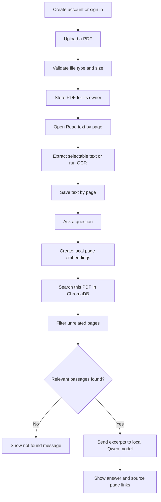

# Docs AI

Docs AI is a local Django app for studying from PDFs. Upload a document, ask a question about it, and get an answer with links to the relevant pages.

It uses Ollama for local AI models. You do not need an OpenAI API key.

## How it works



See [docs/flowchart.md](docs/flowchart.md) for the larger flowchart.

## Features

- Account registration, sign-in, and a private PDF list.
- PDF uploads up to 10 MB, stored under the account that uploaded them.
- Page-by-page text extraction with `pypdf`.
- OCR for scanned or image-based PDFs using Tesseract and Poppler.
- Local semantic search using Ollama's `embeddinggemma` model and ChromaDB.
- Answers generated by the local `qwen3:4b-instruct` model using retrieved PDF passages.
- Relevant page links and matching passages shown with answers.
- Topic matching to filter unrelated search results.
- Code answers displayed with line breaks and indentation.
- Owner-only PDF deletion that also removes its saved page text and search vectors.

## Tools used

- Python 3.13 and Django 6.1
- SQLite for local development
- pypdf for PDF text extraction
- Tesseract OCR, pytesseract, pdf2image, and Poppler for scanned PDFs
- Ollama with `qwen3:4b-instruct` and `embeddinggemma`
- ChromaDB for local vector search
- Django templates, HTML, and CSS

## Run on Windows

### 1. Install the required tools

Install:

- [Python 3.13](https://www.python.org/downloads/)
- [Git for Windows](https://git-scm.com/downloads)
- [Ollama for Windows](https://ollama.com/download/windows)

Tesseract OCR and Poppler are needed only for scanned or image-based PDFs.

### 2. Get the project and install Python packages

Open Command Prompt:

```cmd
git clone https://github.com/kevinbakraniya2-ship-it/docs-ai.git
cd docs-ai
py -3.13 -m venv .venv
.venv\Scripts\activate
python -m pip install -r requirements.txt
```

### 3. Configure the local environment

Create your local `.env` file:

```cmd
copy .env.example .env
python -c "from django.core.management.utils import get_random_secret_key; print(get_random_secret_key())"
```

Copy the generated key into `DJANGO_SECRET_KEY` in `.env`. Keep `.env` private; it is excluded from Git.

For scanned PDFs, set the paths to your local Tesseract and Poppler installations in `.env`. Example:

```text
TESSERACT_CMD="C:/Program Files/Tesseract-OCR/tesseract.exe"
POPPLER_PATH="C:/path/to/Poppler/Library/bin"
```

`POPPLER_PATH` should point to the folder containing `pdfinfo.exe`. Use paths that match your computer.

### 4. Download the local AI models

Make sure Ollama is running, then download both models:

```cmd
ollama pull qwen3:4b-instruct
ollama pull embeddinggemma
```

### 5. Set up and start Django

```cmd
python manage.py migrate
python manage.py runserver
```

Open [http://127.0.0.1:8000/](http://127.0.0.1:8000/), create an account, and upload a PDF.

After uploading, open **Read text by page** once. This extracts and saves the PDF text, using OCR when needed. Then open **Ask this PDF** to ask questions.

## Run the checks

```cmd
python manage.py check
python manage.py test
```

## Project layout

```text
accounts/       Registration, sign-in, and dashboard
config/         Django settings and project URLs
core/           Shared pages and base layout
documents/      PDF uploads, OCR, semantic search, and answers
docs/           Project flowchart
media/          Locally uploaded PDFs; not committed
.vector_store/  Local ChromaDB data; not committed
db.sqlite3      Local development database; not committed
```

## Limits and notes

- OCR is configured for English; results depend on scan quality.
- The app currently supports PDFs up to 100 pages and stores up to 5,000 extracted characters per page.
- The answer model is instructed to use the selected PDF passages, but AI answers can still be imperfect. Check the linked source pages.
- Ollama, extracted text, the database, and vector data run or stay on this computer during local use.
- This is a learning project and is not a production deployment guide.

## Privacy

Documents are limited to their owners in the app. Uploaded files, the local database, `.env`, and ChromaDB data are excluded from Git. The app sends retrieved PDF passages to the Ollama service running locally on your computer; it does not use an OpenAI API key.
