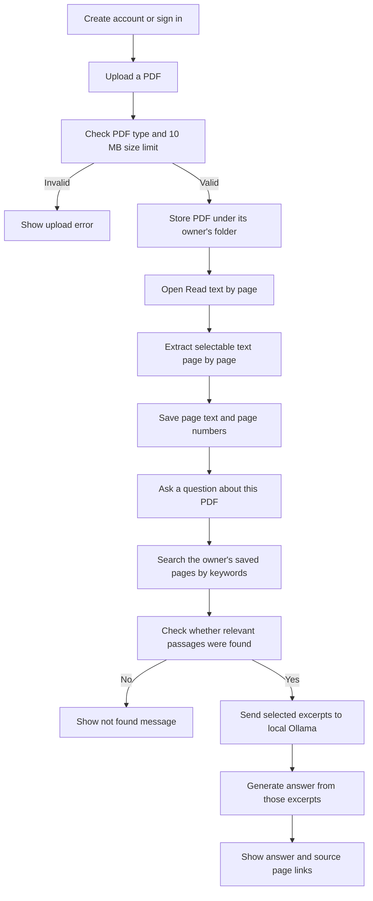

# Docs AI

Docs AI is a small Django web app for studying from PDFs. A student uploads a PDF, asks a question about it, and gets an answer based on matching text from that document, with links to the source pages.

The answer model runs locally through Ollama. The app does not need an OpenAI API key.

## How it works



A larger copy is available in [docs/flowchart.md](docs/flowchart.md).

## What it can do

- Create an account and sign in.
- Upload a PDF up to 10 MB.
- Keep each document attached to its owner; other users cannot open its reading or question pages.
- Extract selectable PDF text one page at a time.
- Search document pages with simple keyword matching.
- Ask local Ollama's qwen3:4b-instruct model for an answer based on the matching passages.
- Show source page links so the answer can be checked against the PDF.
- Format code answers as code while preserving line breaks.

## Tools used

- Python 3.13
- Django 6.1
- SQLite for local development
- pypdf for extracting text and page numbers
- Ollama with the qwen3:4b-instruct model
- Django templates, HTML, and CSS

## Run it on Windows

### 1. Get the project and create an environment

Install Python 3.13 and [Ollama for Windows](https://ollama.com/download/windows), then open Command Prompt:

```cmd
git clone https://github.com/kevinbakraniya2-ship-it/docs-ai.git
cd docs-ai
py -3.13 -m venv .venv
.venv\Scripts\activate
python -m pip install -r requirements.txt
```

### 2. Set a private Django key

```cmd
copy .env.example .env
python -c "from django.core.management.utils import get_random_secret_key; print(get_random_secret_key())"
```

Copy the generated value into the DJANGO_SECRET_KEY line in your local .env file. Keep .env private; it is excluded from Git.

### 3. Download and start the local model

```cmd
ollama run qwen3:4b-instruct
```

The model downloads the first time. Once it responds, Ollama can serve the model locally. Keep Ollama running while using Docs AI.

### 4. Prepare and start Django

```cmd
python manage.py migrate
python manage.py runserver
```

Open http://127.0.0.1:8000/, create an account, upload a PDF, and open Read text by page once before asking questions. This first read extracts and saves the page text.

## Run the checks

```cmd
python manage.py check
python manage.py test documents
```

## Project layout

```text
accounts/       Sign-up and user dashboard
config/         Django settings and URL configuration
core/           Shared pages and base layout
documents/      PDF uploads, text extraction, search, and answers
docs/           Project flowchart
media/          Local uploaded PDFs (not committed)
db.sqlite3      Local development database (not committed)
```

## Current limits

- Scanned or image-only PDFs do not have OCR yet; the PDF needs selectable text.
- Search uses keyword matching, not embeddings or a vector database.
- Check the source pages before relying on an answer. The model is asked not to add details absent from the PDF, but local AI answers can still be imperfect.
- Text extraction currently supports up to 100 pages and stores up to 5,000 characters from each page.
- This is a learning project for local development, not a production deployment recipe.

## Privacy notes

Uploaded PDFs and the local database are excluded from the repository. Documents are owner-scoped in the app. Matching PDF text is sent to the local Ollama service on this computer to generate an answer; no OpenAI API key is used.
