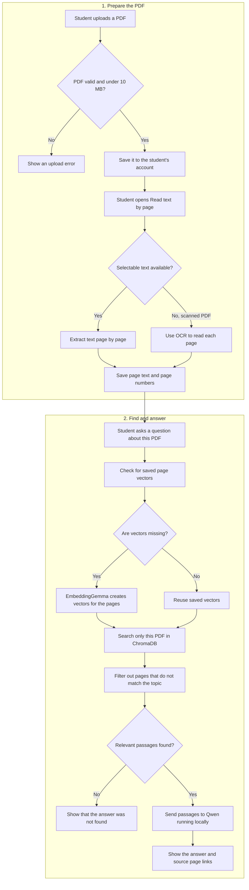

# Docs AI: from PDF to answer

This diagram follows the student's journey. The top half prepares the PDF. The bottom half shows what happens when the student asks a question.

## What the diagram means

1. **Upload:** Docs AI checks the PDF and saves it under the signed-in student's account.
2. **Read:** The student opens **Read text by page**. Docs AI extracts selectable text, or uses OCR for a scanned PDF, and saves the result page by page.
3. **Search:** When a question is asked, EmbeddingGemma creates any missing page vectors. ChromaDB searches the selected PDF, then Docs AI filters out pages that do not match the question's topic.
4. **Answer:** If useful passages are found, the local Qwen model writes an answer from those passages. Docs AI shows links to the source pages so the student can check the answer.
5. **No match:** If no relevant passage is found, Docs AI says it could not find the answer in that PDF.

## Deleting a PDF

From **My PDFs**, the owner can delete a document. Docs AI removes the uploaded PDF, its saved page text, and its ChromaDB vectors.
